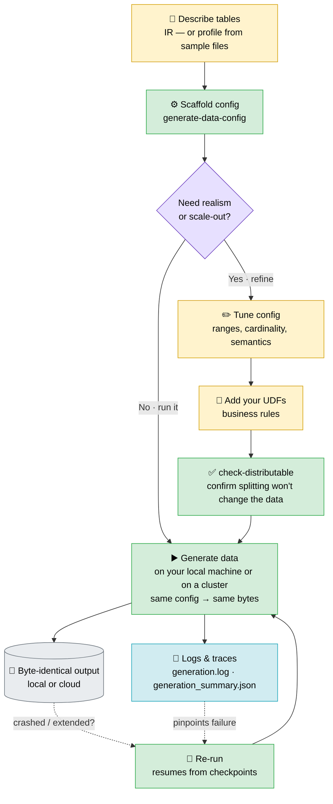

# datagenic

> **A lightweight, versatile & scalable synthetic-data generation package.**
> Describe your tables once — generate plausible, reproducible data, on a laptop or a cluster.

Generating data _right_ is hard in four ways at once. datagenic is built around solving all four:

| The challenge                                                                                                   | How datagenic answers it                                                                       |
| --------------------------------------------------------------------------------------------------------------- | ---------------------------------------------------------------------------------------------- |
| **Realistic data** — real data follows rules (derived, conditional, correlated); fakers only emit canned values | One click scaffolds **Realistic** data — then **fine-tune for full realism** (Claude can help) |
| **Multi-dimensional consistency** — must hold _within a table_, _across tables_, and _over time_, all at once   | Unique **within a table**, valid **across tables**, coherent **over time** — from one seed     |
| **Agile logic** — you must iterate without breaking consistency or what already worked                          | Iterate freely; built-in checks **guarantee you didn't break** earlier results                 |
| **Scale** — a few rows for a test, or billions for a perf run — usually two different tools                     | **One flag** — 100 rows to a billion, one core to a cluster, **identical at every size**       |

`import datagenic` pulls in no cloud SDK; backends load only when you use them.

---

## 1 · Realistic data — scaffold in one click, fine-tune for full realism

Point datagenic at a schema (or a folder of sample files) and it scaffolds a complete,
runnable config with sensible defaults for every column. Where realism matters, refine a
column or plug in your own logic — the scaffold gets you most of the way, you tune the rest.
Already have generation code (pandas/polars/numpy)? Reuse it as a column generator or
post-processor — even a class that returns several related tables at once
([cookbook](docs/cookbook_data_generator.md) → _Reusing existing pandas/polars code_).

- **No schema? Start from data.** `datagenic profile ./samples -o config.json` reads your
  files and _writes the config for you_ — it infers tables, keys & foreign keys, and fits
  value mixes, distributions and null rates. You never hand-author a schema.
- **A domain pack, not a special case.** The engine stays domain-neutral; `market_finance`
  is a pluggable pack that teaches it capital-markets knowledge, **auto-detected by name,
  sample values, or an LLM** (`--infer-semantics heuristic|empirical|agent`) — no tagging.
  Optional and extensible (bring your own domain):
  - **coherent taxonomy** — `asset class → instrument → risk factor` always line up (Rates → IR Swap → IR Curve, never a mismatch)
  - **valid identifiers** — ISIN / CUSIP / SEDOL with real check digits (they pass validators, unique per run)
  - **quantities scaled by asset class** — `notional` & `mtm` come out lognormal at the right magnitude (an Equity notional ≈ \$100k, a Rates notional ≈ tens of millions); a `pnl` array becomes a per-row **time series**
  - **coherent dates** — `maturity = trade_date + tenor`, settlement = trade + lag
  - **tenor-bucketed sensitivities** — a risk ladder (`array(float)`) scaled by asset class, shaped by instrument (bullet vs ladder), and **zeroed beyond maturity** (a trade maturing in 1M has no sensitivity past the 1M bucket)
  - **rolling positions** — an optional **live book** (the `rolling_book` scaffold transform, opted into via `domains={"market_finance": {"transforms": {"rolling_book": {}}}}`): matured trades roll to freshly-booked ones, so every as-of date is a constant-size set of live trades (`trade_date ≤ as-of < maturity`); `trade_date`/`maturity` stay fixed while `tenor` is the remaining maturity (`maturity − as-of`), shrinking as the as-of advances
  - **market dimensions** — currencies, tenors, ratings, GICS sectors, ~1,000 real counterparties, books & desks
- **Accuracy ladder.** `heuristic` gives a plausible guess, `empirical`/`profile` **fit the
  distributions from your real sample**, `agent` covers the long tail — every pick annotated
  for review (`datagenic review-config`) and fully hand-editable.
- **Right-sized reference tables.** With `Configs(reference_rows="auto")` a dimension is
  sized to its **strict minimal grain** — one row per distinct key tuple (`∏ key
  cardinalities`), so a `currencies` table is its real domain, not a guessed row count.
  It becomes a broadcast dimension shared by every fact that references it, and its size is
  **independent of fact volume** — bump the facts to a billion rows and the dimensions don't
  change.

A scaffolded `trades` table generates rows like:

| asset class | instrument    | isin         | trade date | tenor | maturity   |   notional |     mtm |
| ----------- | ------------- | ------------ | ---------- | ----- | ---------- | ---------: | ------: |
| Rates       | IR Swap       | DE000A1B2C39 | 2025-09-15 | 5Y    | 2030-09-15 | 24,300,000 | 312,400 |
| Credit      | CDS           | US12L4F8K2H7 | 2026-05-15 | 3M    | 2026-08-15 |  5,120,000 | -48,900 |
| Equity      | Equity Option | GB00BH4HKS39 | 2026-02-10 | 1Y    | 2027-02-10 |     88,400 |  12,150 |
| FX          | FX Forward    | FR0000131104 | 2026-06-20 | 1M    | 2026-07-20 |  9,750,000 |  87,300 |

Coherent taxonomy, valid identifiers, plausible values, `maturity = trade date + tenor` — **generated, not canned**.

## 2 · Consistency — in every dimension

datagenic enforces consistency where other generators emit independent noise:

- **within a table** — unique keys, valid row-level relationships (a coherent `(asset_class, instrument_type)` pair)
- **across tables** — foreign keys drawn from their reference pools, so `trades.join(instruments, on="isin")` never drops a row
- **over time** — values evolve coherently date to date (the same trade's price is a walk, not re-rolled daily) and keys stay stable; an optional **rolling book** turns positions over as they mature while keeping the book a constant-size set of live trades

All from one seed. datagenic also renders the **lineage** — how every table connects — straight from your config, as a static diagram or an interactive graph.

## 3 · Agile logic — iterate without breaking what worked

Because output is **byte-deterministic** (same seed + config → identical bytes, every run),
a golden test is a real diff:

```text
$ pytest tests/golden
  ✗ orders changed            # exactly where you edited the logic
  ✓ everything else identical  # nothing drifted on its own
```

A red test means _your logic changed_, not a flake. `validate()` and `check-distributable`
catch breakage before a long run. **Claude knows datagenic** — it ships a skill, so you can
describe a change and refine the logic together.

## 4 · Scale — one config, laptop to cluster

Go from a laptop fixture to a billion rows with runtime flags, never a code change:

```bash
datagenic generate-data config.json                   # run A · laptop, sequential
datagenic generate-data config.json --shard 3 --of 8  # run B · one worker of a cluster
# → byte-identical output; sharding is master-free, no Spark
```

1000× the data is **one number** (`"number_of_rows": 1_000 → 1_000_000`), same logic.
Large partitions stream to disk or cloud as they're produced, so peak memory stays bounded;
every file embeds a content hash, so an interrupted or extended run **resumes where it
stopped** — locally _and_ in the cloud.

---

## Workflow

_Describe once → scaffold → (refine ⇄ generate) → anywhere._ The config is the single source
of truth; scale and storage are runtime flags, not changes to your setup. In the graph below,
🟨 **amber** steps need your input, 🟩 **green** steps are click-and-run — the fast path is one
amber box, then all green.



**Legend** — 🟨 you configure (write/edit) · 🟩 click-and-run command · 🟪 decision · ⬜ output · 🟦 logs & traces

## Install

With `uv` (add to your project):

```bash
uv add datagenic                 # core (local generation)
uv add "datagenic[cloud]"        # + Azure Blob / S3 / SFTP storage backends
uv add "datagenic[cloud,agent]"  # + the anthropic SDK for --infer-semantics agent
```

Or with `pip`:

```bash
pip install datagenic            # core (local generation)
pip install "datagenic[cloud]"   # + Azure Blob / S3 / SFTP storage backends
```

Requires Python ≥ 3.12.

## Quickstart

📖 **[Docs](docs/)** · [Data generator cookbook](docs/cookbook_data_generator.md) · [Storage layer cookbook](docs/cookbook_storages.md)

```python
from datagenic import Configs, Generator

# 1 — scaffold a config from a neutral IR (a dict or a path to IR JSON)
source = {
    "name": "shop",
    "tables": [
        {"type": "fact", "name": "orders", "keys": ["order_id"],
         "columns": [{"name": "order_id", "type": "int"}, {"name": "amount", "type": "float"}]},
        {"type": "referential", "name": "products", "keys": ["sku"],
         "columns": [{"name": "sku", "type": "string"}]},
    ],
}
Configs(input=source, output_folder_path="./out").dump(file_path="config.json")

# 2 — generate
Generator(data_generator_config_file="config.json").generate()
```

Or from the CLI:

```bash
datagenic generate-data-config samples/ir/solutions_ir.json -o config.json --output-folder ./out
datagenic generate-data-config ir.json -o config.json --infer-semantics heuristic  # auto-detect domain columns
datagenic profile ./samples -o config.json          # scaffold straight from sample files (no schema)
datagenic review-config config.json                 # list inferred columns to fine-tune

datagenic generate-data config.json                 # sequential
datagenic generate-data config.json --parallel 8    # all local cores (byte-identical to sequential)
datagenic generate-data config.json --shard 1 --of 8  # one worker of a distributed run
datagenic generate-data config.json --tables orders  # a "job": only this table + its upstream closure
datagenic check-distributable config.json           # confirm splitting won't change the data
```

> The `datagenic` command is the console script installed with the package. In a dev checkout, run the same commands with `uv run python -m datagenic.cli …`.

## When to use datagenic (and when not)

datagenic generates **plausible, structure-driven data from a schema you describe** — it's
_not_ learning a distribution from a real dataset. Pick by what you need:

| If you need…                                                                                    | Reach for                                                                                                                            |
| ----------------------------------------------------------------------------------------------- | ------------------------------------------------------------------------------------------------------------------------------------ |
| Reproducible, consistent, custom data **at scale** — from a schema, master-free, self-hosted    | **datagenic**                                                                                                                        |
| Statistical fidelity **learned from real data**                                                 | [SDV](https://github.com/sdv-dev/SDV) · Gretel · MOSTLY AI                                                                           |
| Privacy / de-identification (differential privacy, masking)                                     | Gretel · Tonic · MOSTLY AI                                                                                                           |
| Rich field-level fakes (names, addresses, emails) with **zero config**, or a few throwaway rows | [Faker](https://github.com/joke2k/faker) · [Mimesis](https://github.com/lk-geimfari/mimesis) · [Mockaroo](https://www.mockaroo.com/) |
| Generation **native to Spark / Databricks**                                                     | [dbldatagen](https://github.com/databrickslabs/dbldatagen)                                                                           |
| Edge-case **test inputs** to probe code (not bulk data)                                         | [Hypothesis](https://github.com/HypothesisWorks/hypothesis)                                                                          |

## The IR, and scaffolding from any schema

The **internal representation (IR)** is the native input — a flat
`{name, tables:[{type, name, keys, columns:[{name, type}]}]}`. To scaffold from a
different schema, pass `adaptor=fn` where `fn(source) -> IR` — a small one-time mapper
that turns your source format into the IR. (Profiling from sample files synthesises the IR
for you — the user experience is "files in, config out"; the IR stays an internal contract,
optionally surfaced for inspection.)

See [`docs/`](docs/) for the full cookbooks (data generator, storage layer).

## Logs & traces

Every run writes a structured trace next to the data, under `output_folder_path`:

- **`generation.log`** — an append-only JSON-lines journal: one `START` / `DONE` / `ERROR` record per `(table, date, batch)` unit (`DONE` carries the row count, `ERROR` the exception). Each line is flushed immediately, so a hard kill (OOM, `SIGKILL`) leaves the in-flight unit as a `START` with no matching `DONE` — pinpointing exactly where the process died.
- **`generation_summary.json`** — derived per-table totals (rows, units, errors, elapsed) plus an `errors` list, rewritten **atomically after every unit** so the on-disk summary is always valid JSON, even mid-crash. Read it to see how far a run got and which unit failed.

Errors are re-raised with `table / date / batch` context (the original traceback is preserved as the cause). Distributed runs write one log/summary **per shard** (`generation.shard{i}-of{N}.log`) so workers never clobber each other. Relocate the files with `generation_log_path` / `generation_summary_path`, and set `logger_folder_path` for an additional human-readable text log.

```jsonc
// generation.log — one JSON object per line
{"ts": "2024-01-02T11:03:01", "event": "START", "table": "orders", "date": "2024-01-02", "batch": 3}
{"ts": "2024-01-02T11:03:01", "event": "DONE",  "table": "orders", "date": "2024-01-02", "batch": 3, "rows": 2500}
{"ts": "2024-01-02T11:03:02", "event": "ERROR", "table": "trades", "date": "2024-01-02", "batch": 3, "error": "ValueError: ..."}
```

See [`docs/cookbook_data_generator.md`](docs/cookbook_data_generator.md) → _Logging & recovery_ for the full reference.

## Development

```bash
uv sync          # or: pip install -e ".[cloud]" and the dev group
pytest tests/
```

**Working in this repo with Claude Code?** It ships a `datagenic` skill
([`.claude/skills/datagenic/`](.claude/skills/datagenic/)) that Claude loads for
guidance on the scaffold→generate pipeline, the IR, config authoring & fine-tuning,
post-processors (technical args, batch isolation), distribution, and testing — plus a
`reusing-existing-code-in-datagenic` skill for porting existing pandas/polars/numpy code
into datagenic generators & post-processors.

## License

See [`LICENSE`](LICENSE). _(A license has not yet been selected — the placeholder must be replaced before public distribution.)_
