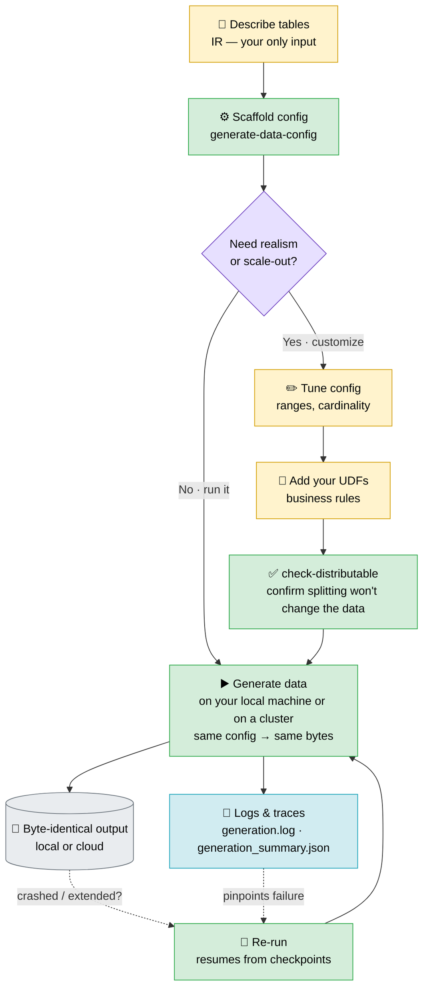

# datagenic

> **A fully self-hosted, versatile and scalable synthetic data generation package.**

## Why datagenic

- **Zero-config to fully custom** — scaffold a complete config straight from your schema with sensible defaults (no setup when realism doesn't matter), then plug in your own UDFs to encode arbitrary business rules and fine-tune the data when it does.
- **Scales without a rewrite** — go from one core to all of them to a cluster with a flag, never a code change; sharded output is byte-identical to a single run.
- **Reproducible to the byte** — same seed + config → identical output, every run. A failing test means your code changed, not your fixtures.
- **Resumable** — every file embeds a content hash, so a re-run skips what's done and picks up where it stopped — locally _and_ in the cloud.
- **Consistent in every dimension** — consistency is enforced *within a table* (unique keys, valid row-level relationships), *across tables* (foreign keys drawn from their reference pools), and *across time* (values evolve consistently date to date, keys stay stable) — not random noise.
- **Streaming writes** — large partitions stream to disk or cloud as they're produced, keeping peak memory bounded even for huge tables.
- **Lightweight core** — `import datagenic` pulls in no cloud SDK; backends load only when you use them.

## When to use datagenic (and when not)

datagenic is built for **structure-driven, reproducible data at any scale** — it generates plausible data from a schema you describe, not realistic data learned from a real dataset. It shines when one or more of these matters: **multi-dimensional consistency** (within a table, across tables, and across time), byte-for-byte reproducibility, a single config that runs from a laptop to a cluster, no source data to learn from, fully self-hosted, and **arbitrarily custom generation logic** you can express in Python.

| Main criterion | Best choice(s) |
| --- | --- |
| Multi-dimensional consistency — within a table, across tables (FKs), and **over time** | **datagenic** · [SDV](https://github.com/sdv-dev/SDV) (within/cross-table) |
| Byte-for-byte reproducibility — same seed/config → identical output | **datagenic** |
| Fully custom generation logic — your own code and rules | **datagenic** (UDFs) · [Faker](https://github.com/joke2k/faker) (field-level) |
| Scale to billions of rows | **datagenic** · [dbldatagen](https://github.com/databrickslabs/dbldatagen) |
| Distributed **without** Spark (master-free) | **datagenic** |
| Distributed **on** Spark / Databricks | dbldatagen |
| Resumable / checkpointed large runs | **datagenic** |
| No source data required — generate from a schema | **datagenic** · dbldatagen · Faker · [Mimesis](https://github.com/lk-geimfari/mimesis) · [Mockaroo](https://www.mockaroo.com/) |
| Statistical fidelity learned from real data | SDV · Gretel · MOSTLY AI · YData |
| Privacy / de-identification — differential privacy, masking | Gretel · MOSTLY AI · Tonic |
| Self-hosted — data never leaves your environment | **datagenic** · SDV · dbldatagen · Faker · Mimesis |
| Hosted — zero infra to run | Mockaroo · Gretel · MOSTLY AI |
| Quick single-table mock data, minimal setup | Faker · Mimesis · Mockaroo |
| Edge-case **test inputs** to probe code (not bulk datasets) | [Hypothesis](https://github.com/HypothesisWorks/hypothesis) |

In short: reach for datagenic when you care about **multi-dimensional consistency (within/across tables and over time) + reproducibility + custom generation logic + a path to scale**; reach for a field-level faker when you just need a few throwaway rows, or for an ML/privacy tool when fidelity to real data is the point.

## Workflow

_Describe once → scaffold → (optionally customize) → generate anywhere._ The config is the single source of truth; scale and storage are runtime flags, not changes to your setup. In the graph below, 🟨 **amber** steps need your input, 🟩 **green** steps are click-and-run — the fast path is one amber box, then all green.



**Legend** — 🟨 you configure (write/edit) · 🟩 click-and-run command · 🟪 decision · ⬜ output · 🟦 logs & traces

## Install

With `uv` (add to your project):

```bash
uv add datagenic            # core (local generation)
uv add "datagenic[cloud]"   # + Azure Blob / S3 / SFTP storage backends
```

Or with `pip`:

```bash
pip install datagenic            # core (local generation)
pip install "datagenic[cloud]"   # + Azure Blob / S3 / SFTP storage backends
```

Requires Python ≥ 3.12.

## Quickstart

📖 **[Docs](docs/)** · [Data generator cookbook](docs/cookbook_data_generator.md) · [Storage layer cookbook](docs/cookbook_storages.md)

```python
from datagenic import Configs, Generator

# 1 — scaffold a config from a neutral IR (a dict or a path to IR JSON)
source = {
    "name": "shop",
    "tables": [
        {"type": "fact", "name": "orders", "keys": ["order_id"],
         "columns": [{"name": "order_id", "type": "int"}, {"name": "amount", "type": "float"}]},
        {"type": "referential", "name": "products", "keys": ["sku"],
         "columns": [{"name": "sku", "type": "string"}]},
    ],
}
Configs(input=source, output_folder_path="./out").dump(file_path="config.json")

# 2 — generate
Generator(data_generator_config_file="config.json").generate()
```

Or from the CLI:

```bash
datagenic generate-data-config samples/ir/solutions_ir.json -o config.json --output-folder ./out
datagenic generate-data config.json                 # sequential
datagenic generate-data config.json --parallel 8    # all local cores
datagenic generate-data config.json --shard 1 --of 8  # one worker of a distributed run
datagenic check-distributable config.json           # confirm splitting won't change the data
```

> The `datagenic` command is the console script installed with the package. In a dev checkout, run the same commands with `uv run python -m datagenic.cli …`.

## The IR, and scaffolding from any schema

The **internal representation (IR)** is the native input — a flat
`{name, tables:[{type, name, keys, columns:[{name, type}]}]}`. To scaffold from a
different schema, pass `adaptor=fn` where `fn(source) -> IR` — a small one-time mapper
that turns your source format into the IR.

See [`docs/`](docs/) for the full cookbooks (data generator, storage layer).

## Logs & traces

Every run writes a structured trace next to the data, under `output_folder_path`:

- **`generation.log`** — an append-only JSON-lines journal: one `START` / `DONE` / `ERROR` record per `(table, date, batch)` unit (`DONE` carries the row count, `ERROR` the exception). Each line is flushed immediately, so a hard kill (OOM, `SIGKILL`) leaves the in-flight unit as a `START` with no matching `DONE` — pinpointing exactly where the process died.
- **`generation_summary.json`** — derived per-table totals (rows, units, errors, elapsed) plus an `errors` list, rewritten **atomically after every unit** so the on-disk summary is always valid JSON, even mid-crash. Read it to see how far a run got and which unit failed.

Errors are re-raised with `table / date / batch` context (the original traceback is preserved as the cause). Distributed runs write one log/summary **per shard** (`generation.shard{i}-of{N}.log`) so workers never clobber each other. Relocate the files with `generation_log_path` / `generation_summary_path`, and set `logger_folder_path` for an additional human-readable text log.

```jsonc
// generation.log — one JSON object per line
{"ts": "2024-01-02T11:03:01", "event": "START", "table": "orders", "date": "2024-01-02", "batch": 3}
{"ts": "2024-01-02T11:03:01", "event": "DONE",  "table": "orders", "date": "2024-01-02", "batch": 3, "rows": 2500}
{"ts": "2024-01-02T11:03:02", "event": "ERROR", "table": "trades", "date": "2024-01-02", "batch": 3, "error": "ValueError: ..."}
```

See [`docs/cookbook_data_generator.md`](docs/cookbook_data_generator.md) → _Logging & recovery_ for the full reference.

## Development

```bash
uv sync          # or: pip install -e ".[cloud]" and the dev group
pytest tests/
```

## License

See [`LICENSE`](LICENSE). _(A license has not yet been selected — the placeholder must be replaced before public distribution.)_
