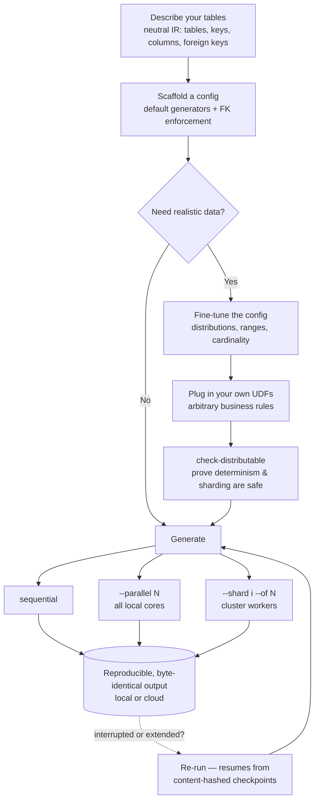

# datagenic

> **A lightweight, versatile and scalable synthetic-data generation package.**

## Why datagenic

- **Zero-config to fully custom** — scaffold a complete config straight from your schema with sensible defaults (no setup when realism doesn't matter), then plug in your own UDFs to encode arbitrary business rules and fine-tune the data when it does.
- **Scales without a rewrite** — go from one core to all of them to a cluster with a flag, never a code change; sharded output is byte-identical to a single run.
- **Reproducible to the byte** — same seed + config → identical output, every run. A failing test means your code changed, not your fixtures.
- **Resumable** — every file embeds a content hash, so a re-run skips what's done and picks up where it stopped — locally _and_ in the cloud.
- **Realistic & referentially correct** — foreign keys and key integrity are enforced out of the box — not random noise.
- **Lightweight core** — `import datagenic` pulls in no cloud SDK; backends load only when you use them.

## Workflow

_Describe once → scaffold → (optionally customize) → generate anywhere._ The config is the single source of truth; scale and storage are runtime flags, not changes to your setup.



## Install

```bash
pip install datagenic            # core (local generation)
pip install "datagenic[cloud]"   # + Azure Blob / S3 / SFTP storage backends
```

Requires Python ≥ 3.11.

## Quickstart

```python
from datagenic import Configs, Generator

# 1 — scaffold a config from a neutral IR (a dict or a path to IR JSON)
source = {
    "name": "shop",
    "tables": [
        {"kind": "fact", "name": "orders", "keys": ["order_id"],
         "columns": [{"name": "order_id", "type": "int"}, {"name": "amount", "type": "float"}]},
        {"kind": "dimension", "name": "products", "keys": ["sku"],
         "columns": [{"name": "sku", "type": "string"}]},
    ],
}
Configs(input=source, output_folder_path="./out").dump(file_path="config.json")

# 2 — generate
Generator(data_generator_config_file="config.json").generate()
```

Or from the CLI:

```bash
datagenic generate-data-config samples/ir/solutions_ir.json -o config.json --output-folder ./out
datagenic generate-data config.json                 # sequential
datagenic generate-data config.json --parallel 8    # all local cores
datagenic generate-data config.json --shard 1 --of 8  # one worker of a distributed run
datagenic check-distributable config.json           # verify sharding is byte-safe
```

## The IR, and scaffolding from any schema

The **internal representation (IR)** is the native input — a flat
`{name, tables:[{kind, name, keys, columns:[{name, type}]}]}`. To scaffold from a
different schema, pass `adaptor=fn` where `fn(source) -> IR` — a small one-time mapper
that turns your source format into the IR.

## Key properties

- **Deterministic & reproducible** — per-unit seeded RNG; same seed/config → identical bytes.
- **Distributable** — shard batches across workers with no master and no per-worker config edits; the union is one dataset.
- **Checkpointed** — every output embeds a content hash; re-running resumes where it stopped (local _and_ cloud).
- **Streaming writes** — large partitions stream to disk/cloud to bound peak memory.

See [`docs/`](docs/) for the full cookbooks (data generator, storage layer).

## Development

```bash
uv sync          # or: pip install -e ".[cloud]" and the dev group
pytest tests/
```

## License

See [`LICENSE`](LICENSE). _(A license has not yet been selected — the placeholder must be replaced before public distribution.)_
