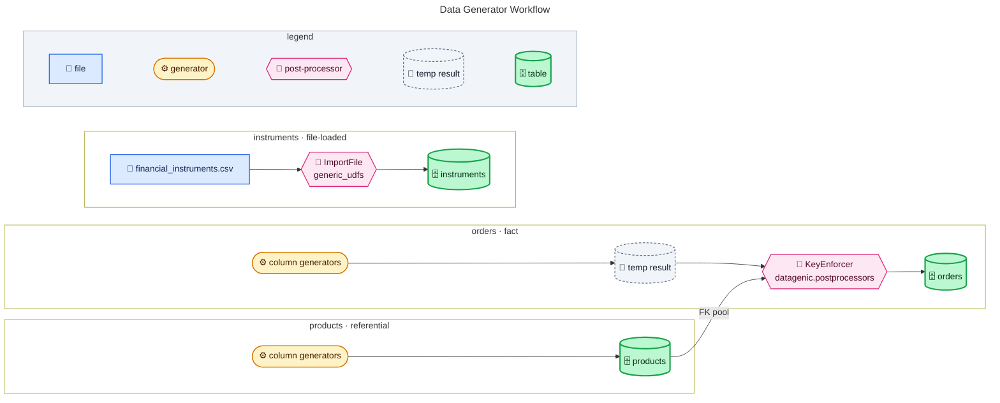

# Cookbook — Data Generator

---

## Quickstart: scaffold a config and generate data

`Configs` scaffolds from a neutral **internal representation (IR)** — a flat,
source-agnostic description of the tables to generate. Pass an IR (a dict or a JSON
path) directly; no adaptor needed. A frozen sample IR ships in `samples/ir/`:

```python
from datagenic import Configs, Generator

ir_path = "samples/ir/solutions_ir.json"
config_path = "samples/data_generation_config/my_config.json"

# 1 — Scaffold a config from the data model (native IR input)
Configs(
    input=ir_path,                # an IR dict or a path to IR JSON
    storage_type="local",         # "local" or "azure_blob"
    output_format="parquet",      # "parquet", "csv", or "avro"
    output_folder_path="samples/data_generator/output",
    start_date="2024-01-01",
    end_date="2024-01-05",
    number_of_batches=2,
    number_of_rows_in_fact_tables=2500,
    number_of_rows_in_non_fact_tables=100,
    seed=0,
).dump(file_path=config_path)

# 2 — Generate the data
Generator(data_generator_config_file=config_path).generate()
```

> Already have your tables described in another format? Map it to the IR with a small
> `adaptor` function — see _scaffold from another schema_ below.

---

## The native input: the IR (and scaffolding from any JSON)

`Configs` scaffolds from a **neutral internal representation (IR)** — a flat,
source-agnostic description of the tables to generate. The IR is the _native_ input:
pass it directly, no adaptor.

```python
from datagenic import Configs

source = {
    "name": "shop",
    "tables": [
        {"type": "fact", "name": "orders", "keys": ["order_id"],
         "columns": [{"name": "order_id", "type": "int"}, {"name": "amount", "type": "float"}]},
        {"type": "referential", "name": "products", "keys": ["sku"],
         "columns": [{"name": "sku", "type": "string"}]},
    ],
}
Configs(input=source).dump(file_path="config.json")  # no adaptor
```

The IR shape (an invalid shape fails fast with a clear error naming the problem):

```python
{
  "name": "<model name>",
  "tables": [
    {
      "name": "orders",
      "type": "fact",                  # "fact" or "referential" (optional, default "referential")
      "keys": ["order_id"],            # unicity-key column names
      "columns": [{"name": "order_id", "type": "int"}, …],
      "foreign_keys": [                # optional, fact tables — drives FK enforcement
        {"column": "sku", "references": "products.sku"}   # references: str | [str]
      ],
    },
    …
  ],
}
```

### `type`: fact vs referential

`type` tells the scaffolder how to treat each table — it changes two things in the
generated config (and nothing else; `type` itself is not written into the config):

- **`fact`** — the large, _referencing_ table(s) of your model (trades, orders, events…).
  Scaffolded with `number_of_rows_in_fact_tables` rows (default **2500**), and its
  `foreign_keys` are honored: a `KeyEnforcer` post-processor is wired on so every FK
  column draws only from the referenced table's value pool (referential integrity).
- **`referential`** (the default) — a smaller reference/lookup table that fact tables
  point at (currencies, products, counterparties…). Scaffolded with
  `number_of_rows_in_non_fact_tables` rows (default **100**). A `foreign_keys` block on
  a referential table is ignored.

So: mark a table `fact` to make it big and FK-enforced; leave it `referential` (or omit
`type`) for a small pool that fact tables reference. Both row counts are configurable on
`Configs(...)` (and overridable per table in the generated config).

### Size reference tables to their grain (`reference_rows="auto"`)

Instead of a flat `number_of_rows_in_non_fact_tables`, let each reference table size itself
to its **strict minimal grain** — one row per distinct unicity-key tuple:

```python
Configs(input=ir, semantic_inferrer="heuristic", reference_rows="auto").dump("config.json")
```

- `number_of_rows = ∏ cardinality(unicity key)`. A **bounded** key (a fixed-vocabulary
  generator such as `currency`, or a `list_of_values`) uses its real domain; a **free**
  synthetic-id key uses the `number_of_rows_in_non_fact_tables` budget. Only when **two or
  more** keys are free is that budget split evenly across them (the sole case cardinalities
  are equalized) — otherwise each key keeps its own size.
- Auto references become **broadcast dimensions** (`single_batch`/`single_date`): generated
  once and shared by every fact that references them, so their size is **independent of fact
  volume** (scale the facts freely; the dimensions don't change). Composite keys are
  enumerated exactly (`scale_unique_by_construction`).
- Default is `reference_rows=None` (legacy flat sizing) — the feature is opt-in and additive.
- **Caveat:** a table whose *sole* unicity key is a bounded vocabulary is *sampled*, not
  enumerated, so it can fall short of its full domain (≈0.63× for an N-value domain over N
  rows) — a warning is emitted. Use a composite key or an explicit `number_of_rows` when you
  need every domain value exactly.

**Scaffold from another schema — pass `adaptor=fn`**, where `fn(source) -> IR` maps
your structure into the IR. The adaptor is a plain function: take whatever shape your
schema has and return the IR dict. For example, suppose your models are described as
entities with a `role`, a primary key, and a `name: type` field map:

```python
from datagenic import Configs

# Your own schema (any shape you like — this is just an example)
my_schema = {
    "dataset": "shop",
    "entities": [
        {"table": "orders", "role": "fact", "pk": ["order_id"],
         "fields": {"order_id": "int", "sku": "string", "amount": "float"},
         "refs": {"sku": "products.sku"}},
        {"table": "products", "role": "dimension", "pk": ["sku"],
         "fields": {"sku": "string", "name": "string"}},
    ],
}

def my_adaptor(source: dict) -> dict:
    """Map a custom schema into datagenic's IR (`fn(source) -> IR`)."""
    return {
        "name": source["dataset"],
        "tables": [
            {
                "name": e["table"],
                "type": "fact" if e["role"] == "fact" else "referential",
                "keys": e.get("pk", []),
                "columns": [{"name": n, "type": t} for n, t in e["fields"].items()],
                "foreign_keys": [
                    {"column": col, "references": ref}
                    for col, ref in e.get("refs", {}).items()
                ],
            }
            for e in source["entities"]
        ],
    }

Configs(input=my_schema, adaptor=my_adaptor).dump(file_path="config.json")
```

Or from the CLI (`--adaptor module:function`, pointing at your adaptor):

```bash
# native IR — no adaptor
uv run python -m datagenic.cli generate-data-config '{"name":"shop","tables":[...]}' \
  -o config.json

# custom schema — via your own adaptor
uv run python -m datagenic.cli generate-data-config my_schema.json \
  -o config.json --adaptor mypkg.adaptors:my_adaptor
```

---

## Profile from a sample (scaffold a config from data files — no IR)

Already have representative data? Point datagenic at a folder of sample files and
get a config back — **you never author an IR**. It infers the tables, columns,
key & foreign-key candidates and *fits generator args* (cardinality, mean/std,
value frequencies, null rate) from the data.

```bash
datagenic profile ./samples -o config.json                 # ./samples/<table>.parquet|.csv per table
datagenic profile ./samples -o config.json --emit-ir ir.json   # also dump the synthesised IR for review
datagenic profile ./samples -o config.json --infer-semantics empirical  # + finance generators from values
datagenic generate-data config.json
```

```python
from datagenic import build_config, Generator

config, ir = build_config(
    {"customers": customers_df, "orders": orders_df},   # frames or paths; or a directory string
    output_folder_path="./out", number_of_batches=1,
)
Generator(data_generator_config_file=config).generate()
```

What it fits per column: dtype → IR type; all-distinct int/string → a **key**;
value-set ⊆ another table's key → a **foreign key** (nullable if it has nulls);
low-cardinality → `list_of_values` + observed `probabilities`; high-cardinality →
`cardinality`; float → `mu`/`sigma`; null fraction → `null_spec.rate`. Per-table
row counts are taken from the sample so regenerated volume matches.

The IR is **synthesised internally** (the engine is IR-driven) and only surfaced
with `--emit-ir` — from your side it's just *files in, `config.json` out*. Key/FK
detection is heuristic: review the emitted IR (or `config.json`) and hand-edit
anything it guessed wrong.

---

## Domain-aware scaffolding: financial-markets generators + automatic inference

By default a `string` column scaffolds to `prefix_N`-style values. For a recognised
**domain** you can get realistic, internally-coherent values instead — datagenic ships
a financial-markets generator family and an inference layer that wires them
automatically, **without hand-tagging the IR**.

### The finance generators (`datagenic.domains.market_finance.generators`)

- **Coherent taxonomy** — `FinancialAssetClass` → `FinancialInstrumentType` →
  `FinancialRiskFactorGroup`. The two child generators read the partial row (the
  columns already built this unit) and sample only values valid for that row's asset
  class, so `(asset_class, instrument_type)` pairs are always taxonomy-valid (Rates → IR
  Swap, Credit → CDS, …). **Coherence requires the parent column to be generated first**
  — list `asset_class` before its dependents (the scaffolder reorders inferred ones for
  you).
- **Market dimensions** — `Currency` (ISO 4217), `CurrencyPair`, `Tenor`, `CreditRating`
  (`scale="SP"|"Moody"`), `GICSSector`.
- **Identifiers** — `ISIN`/`CUSIP`/`SEDOL` with valid check digits (unique per batch when
  used as a key), plus composed `InstrumentName`/`RiskFactorName` (e.g. `"EUR IR Swap 5Y"`).
- **Org** — `Counterparty`, `TradingBook`, `Desk`.

These are ordinary generators referenced by string in the config, so you can also wire
one by hand (`"udf_module": "datagenic.domains.market_finance.generators", "udf_name": "Currency"`).

### Realistic numeric quantities (flat and conditional)

Inference covers **numbers**, not just categoricals — so a quantitative fact column comes
out with a plausible magnitude and shape instead of the generic `N(1000, 100)`. Float
columns whose name matches a quantity (`notional`, `price`, `quantity`, `rate`, `spread`,
`pv`, `fx_rate`) are wired to a distribution-aware generator with a book-agnostic prior:

- **Distribution** — `RandomFloats`/`BrownianFloats` gained a `distribution` arg:
  `"lognormal"` (positive, right-skewed; `mu` is the **median in real units**, `sigma` the
  log-space spread — for magnitudes like notionals/prices) or `"normal"` (the default,
  byte-identical to before — for rates/spreads). Use `BrownianFloats` for a value that
  evolves over dates (a price), `RandomFloats` for one fixed across dates (a notional).
- **Conditional** — a `notional` maps to `ConditionalFloats`, whose per-row distribution
  depends on the row's category. It reads a parent column (`by_column`, e.g. `asset_class`)
  from the partial row and draws from the matching `cases` entry, so an **Equity** notional
  comes out ≈ \$100k while a **Rates** notional ≈ tens of millions — orders of magnitude
  apart, coherent with the asset class. The parent must be generated first (the scaffolder
  reorders it); with no parent column it falls back to a flat `default`.

```jsonc
// scaffolded notional (asset_class present in the table)
{"col_name": "notional",
 "column_generator": {
   "udf_module": "datagenic.generators", "udf_name": "ConditionalFloats",
   "args": {"by_column": "asset_class",
            "cases": {"Equity": {"distribution": "lognormal", "mu": 1e5, "sigma": 0.8},
                      "Rates":  {"distribution": "lognormal", "mu": 2.5e7, "sigma": 1.0}},
            "default": {"distribution": "lognormal", "mu": 1e6, "sigma": 1.0}}},
 "_inferred": {"semantic": "notional", "parent": "asset_class", "by": "heuristic"}}
```

Numeric inference is gated by **type** (an int id or a string label is never treated as a
quantity) and, because the default distribution is `normal`, it leaves existing float
output byte-identical — golden-neutral and opt-in like the categorical side.

**Array-typed quantities (e.g. a PnL time series).** The same applies to `array(float)`
columns — a per-row vector/series. `RandomArrayFloats`/`BrownianArrayFloats` gained the
`distribution` arg plus `path` (`"iid"` independent elements, or `"walk"` — a cumulative
per-row series, e.g. a PnL path). A `pnl` array column maps to `ConditionalArrayFloats`,
whose per-row array volatility depends on `asset_class` (a Rates book's PnL path swings
wider than an Equity book's); `returns`/`curve` map to flat array generators. The column's
**type decides scalar vs array** — `pnl` as `float` is a signed scalar, `pnl` as
`array(float)` is a `pnl_series` — so the same name never cross-wires. `profile`/`empirical`
fit the element family/params *and* the array length from a sample; `agent` proposes them
(plus `size_of_arrays`).

### Let the scaffolder detect them

Pass `semantic_inferrer=` to `Configs` (or `--infer-semantics` on the CLI). Three
strategies:

| Strategy | Basis | Needs |
|---|---|---|
| `heuristic` | column-name patterns (`ccy`→currency, `isin`→isin, `asset_class`→asset_class, `notional`→notional, …); numeric quantities use the curated prior | nothing |
| `empirical` | real sample values (ISO-4217 membership, ISIN/CUSIP/SEDOL checksum, taxonomy vocab); **fits** numeric distributions (family + params, per-category `cases`) from the sample; falls back to names when no sample | `samples=` |
| `agent` | an LLM (Claude) for ambiguous columns; also proposes a numeric family + scale (and conditioning column) | `pip install 'datagenic[agent]'` + `ANTHROPIC_API_KEY` |

The numeric strategies form an accuracy ladder: `heuristic` = a plausible curated guess,
`empirical`/`profile` = **fitted from your data** (the authoritative path), `agent` = the long
tail with no curated prior.

```python
from datagenic import Configs

ir = {
    "name": "market_risk",
    "tables": [{
        "type": "fact", "name": "trades", "keys": ["trade_id"],
        "columns": [
            {"name": "trade_id", "type": "int"},
            {"name": "asset_class", "type": "string"},
            {"name": "instrument_type", "type": "string"},
            {"name": "ccy", "type": "string"},
            {"name": "tenor", "type": "string"},
            {"name": "isin", "type": "string"},
        ],
    }],
}
Configs(input=ir, semantic_inferrer="heuristic").dump(file_path="config.json")
```

```bash
# heuristic (names only) — dependency-free
datagenic generate-data-config ir.json -o config.json --infer-semantics heuristic

# value-based — point at a directory of <table>.parquet / <table>.csv samples
datagenic generate-data-config ir.json -o config.json --infer-semantics empirical --samples ./samples

# LLM — opt-in
datagenic generate-data-config ir.json -o config.json --infer-semantics agent
```

Inference runs **at scaffold time only** — it writes a normal, frozen config, so
generation stays byte-identical regardless of how the config was authored. Each
auto-selected column carries an `_inferred` block (semantic, confidence, source); the
engine ignores it.

### Review and fine-tune

```bash
datagenic review-config config.json   # lists inferred columns, lowest confidence first
```

Then hand-edit `config.json` — swap a wrong `udf_name`, set `list_of_values`/
`probabilities`, or restrict the domain via `cardinality` (a finance categorical honors
`cardinality` as a cap; it can't exceed its vocabulary). An explicit `semantic` on an IR
column overrides inference.

> **Finance categoricals as unicity keys.** Each declares its true distinct count via
> `cardinality()`, so the engine budgets the *other* keys correctly (no row-count
> collapse). But a small domain can't be a high-cardinality key on its own — pair it with
> an id/incremental key (e.g. `keys: ["trade_id", "asset_class"]`). If the keys are
> mathematically too small for the requested rows, generation warns with the achievable
> ceiling instead of silently dropping rows.

---

## Missing values (null injection)

Any non-key column can carry an optional **`null_spec`** so a fraction of its
values come out null — useful for realistic, incomplete data. Add the IR hints
`null_rate` (and optionally `null_when`); the scaffolder turns them into a
`null_spec` on the column:

```python
Configs(input={
    "name": "shop",
    "tables": [{
        "type": "fact", "name": "orders", "keys": ["order_id"],
        "columns": [
            {"name": "order_id", "type": "int"},
            {"name": "amount",   "type": "float",  "null_rate": 0.1},   # 10% missing at random
            {"name": "coupon",   "type": "string", "null_when": "_table['amount'] > 1000"},  # MAR
        ],
    }],
}).dump(file_path="config.json")
```

In the generated config that becomes, e.g.:

```jsonc
{"col_name": "amount", "col_type": "float", "is_unicity_key": false,
 "column_generator": { ... },
 "null_spec": {"rate": 0.1}}
```

- **`rate`** — probability a value is nulled (0–1; defaults to 1.0 when only
  `when` is given).
- **`when`** — a boolean expression over `_table` (the columns generated *before*
  this one), restricting nulls to matching rows. `null_spec: {"rate": 0.3,
  "when": "_table['status'] == 'pending'"}` nulls 30% of the pending rows.

The mask is drawn from a per-`(table, column, date, batch)` RNG, so it's
**deterministic and shard-safe**, and adding `null_spec` to one column never
changes another column's values. You can also add/edit `null_spec` directly in
the config.

> Nulls on a **unicity key** are rejected by validation (they'd break key dedup
> and FK pools). A nullable **foreign-key** column is better expressed through
> `KeyEnforcer` (FK enforcement runs after generation and would overwrite a
> column-level null mask).

---

## Optional & fan-out foreign keys

FK enforcement (the `KeyEnforcer` wired onto fact tables) can also shape the
*relationship*, via two optional hints on an IR `foreign_keys` entry:

```python
Configs(input={
    "name": "shop",
    "tables": [
        {"type": "referential", "name": "customers", "keys": ["id"],
         "columns": [{"name": "id", "type": "string"}]},
        {"type": "fact", "name": "orders", "keys": ["order_id"],
         "columns": [{"name": "order_id", "type": "int"}, {"name": "customer_id", "type": "string"}],
         "foreign_keys": [{
             "column": "customer_id", "references": "customers.id",
             "null_rate": 0.1,                                  # optional FK: 10% of orders have no customer
             "fanout": {"dist": "uniform", "min": 1, "max": 5}, # each customer referenced ~1–5 times
         }]},
    ],
}).dump(file_path="config.json")
```

- **`null_rate`** — makes the FK optional: that fraction of child rows get a null
  FK (the rest still draw only from the parent's key pool — no orphans).
- **`fanout`** — controls multiplicity via a target-count distribution, trimmed/
  padded to the child row count. `dist` (default `"uniform"`) picks the family:
  `"uniform"` references every parent ~`min..max` times (a flat relationship);
  `"zipf"` (exponent `s` > 1, e.g. `{"dist": "zipf", "s": 2.0}`) is heavy-tailed —
  a few parents get most of the references, most are referenced once (realistic
  customer/order concentration). The mean per-parent count is pinned to
  `child_rows / pool_size` either way; the family shapes the *spread*.

Both are **deterministic and batch-local**, so the table stays shardable
(`datagenic check-distributable` passes). They apply to **non-key** FK columns
only. The fan-out guarantee is *per batch* (across batches it's the sum, not a
hard global min/max); a true global bound needs a `single_batch` reference table.

---

## Scaling up: one config, generate anywhere

Write **one config**, then scale by adding a flag. Every form below produces
**byte-identical** output — distributing is a work split, not a data change.

> Commands run through the project environment with `uv run` (one-time setup:
> `uv sync`). If you've activated the venv instead, drop the `uv run` prefix.

Copy-paste, end to end (uses the sample IR shipped in the repo):

```bash
# 1 — scaffold a config from the sample IR (native input, no adaptor)
uv run python -m datagenic.cli generate-data-config samples/ir/solutions_ir.json \
  -o my_config.json --output-folder ./out \
  --rows-fact 2000 --rows-dict 100 --batches 8 \
  --start-date 2024-01-01 --end-date 2024-01-05 --seed 0

# 2 — generate (single machine, sequential)
uv run python -m datagenic.cli generate-data my_config.json
```

**Use all local cores** (one machine, multicore):

```bash
uv run python -m datagenic.cli generate-data my_config.json --parallel 8
```

**Distribute across machines/workers** — no master, no per-worker config edits.
Worker `i` of `N` generates a disjoint batch slice (shards are **1-based**: `1 … N`);
all write into the same `--output-folder`, so the union is one dataset (point
downstream at `./out`):

```bash
# launch one per worker (SLURM array, k8s Job, etc.)
uv run python -m datagenic.cli generate-data my_config.json --shard 1 --of 8
uv run python -m datagenic.cli generate-data my_config.json --shard 2 --of 8
# ...through --shard 8 --of 8, or run all 8 shards locally in parallel:
seq 1 8 | xargs -P8 -I{} uv run python -m datagenic.cli generate-data my_config.json --shard {} --of 8
```

**Check it's safe to distribute** before spending cluster time (run it on your
config; green = the union of shards is provably byte-identical to a single run):

```bash
uv run python -m datagenic.cli check-distributable my_config.json
```

### Generate a subset — a "job"

To produce only part of the model, pass `--tables` (CLI) or `generate(tables=[...])`
(API): the run generates the given **root table(s) plus their full transitive upstream
closure** — every table they depend on via `udf_args._input_tables`, the global
`postprocessor_args._input_tables`, and dynamic `number_of_rows.from_table` — and
nothing else.

```bash
# produces `orders` AND its FK reference tables (e.g. products, fx_dim); unrelated tables are skipped
uv run python -m datagenic.cli generate-data my_config.json --tables orders
```

```python
Generator("my_config.json").generate(tables=["orders"])   # or a list of roots
```

The closure is self-contained (a fact table's FK pools come along, so references
resolve), and seeds are untouched — so each table in the job is **byte-identical to the
same table in a full run** (and checkpoint-compatible: tables already on disk from a
prior run are reused). A job composes with `--parallel`/`--shard` (table-subset ×
batch-subset are orthogonal).

### Uniqueness guarantees (and their limits) — read before trusting keys

| Scope                                   | Unicity keys unique?                                                         |
| --------------------------------------- | ---------------------------------------------------------------------------- |
| Within a `(date, batch)` partition      | **Yes**                                                                      |
| Across batches / shards (same date)     | **Yes** — disjoint per-batch key ranges                                      |
| Across dates                            | **Only if the key includes the `Date` column** (the default for fact tables) |
| Tables produced by a **post-processor** | **No** — the framework enforces nothing; your post-processor owns uniqueness |

`check-distributable` is what verifies a post-processor is actually shardable
(deterministic + each shard independent). A post-processor that uses `np.random`
(instead of the injected `_rng`), keeps cross-batch state, or reads other batches
from disk will fail it — fix it before distributing.

### Huge runs: lower peak memory (optional `default_parameters` flags)

Both default to off and leave output byte-identical until enabled:

- `"scale_skip_global_key_sort": true` — drop the per-partition key sort (needed to
  stream very large partitions).
- `"scale_unique_by_construction": true` — make composite keys unique by
  construction instead of a de-dup pass.

---

## Logging & recovery

### Logs

Every run writes two files under `output_folder_path` (relocatable via
`default_parameters`):

| File                      | Contents                                                                                 | Override key              |
| ------------------------- | ---------------------------------------------------------------------------------------- | ------------------------- |
| `generation.log`          | one JSON line per unit — `START` / `DONE` (rows) / `ERROR` (with the table, date, batch) | `generation_log_path`     |
| `generation_summary.json` | per-table totals (rows, units, errors, elapsed) + an `errors` list                       | `generation_summary_path` |

The summary is rewritten **atomically after every unit**, so even if a run crashes
the partial summary on disk is always valid JSON — read it to see exactly how far a
run got and which table/date/batch failed. (Set `logger_folder_path` to also get a
classic text log.) Distributed runs write one log/summary **per shard**
(`generation.shard{i}-of{N}.log`) so workers don't clobber each other.

### Recovery — just re-run

Generation is **checkpointed**: every parquet embeds a hash of the content-config,
and a re-run **reuses any file whose hash matches**, regenerating only what's
missing. So after a crash (or an OOM, or a killed worker) you **re-run the same
command** and it resumes where it stopped — no flags, no manual cleanup. The same
holds per shard in a distributed run.

```bash
# crashed at batch 5 of 8 → just run it again; batches 1–4 are reused
uv run python -m datagenic.cli generate-data my_config.json
```

Recovery works for **local _and_ cloud** output. For a cloud target (`azure_blob`)
the resume check reads only each finished file's parquet **footer** (a tiny ranged
read — not a full download) to validate its hash, so already-uploaded units are
skipped, not regenerated and re-uploaded.

Finer control is available from the Python API (`Generator.generate(...)`):

```python
from datagenic import Generator

gen = Generator(data_generator_config_file="my_config.json")

gen.generate()                        # resume (default): reuse valid checkpoints
gen.generate(force_regenerate=True)   # ignore checkpoints, regenerate everything
gen.generate(extend=True)             # add newly-appended dates to an existing run
gen.generate(dry_run=True)            # print the plan (tables × dates × batches), write nothing
```

Note: changing the data spec (generators, seed, row counts) changes the config hash,
so stale files are **not** reused — you won't silently mix old and new data. Only
re-locating the output / changing dates preserves reuse (that's what `extend` is for).

---

## Config file structure

### `default_parameters`

| Parameter                 | Description                                                                                                                                                |
| ------------------------- | ---------------------------------------------------------------------------------------------------------------------------------------------------------- |
| `output_format`           | `"parquet"`, `"csv"`, or `"avro"`                                                                                                                          |
| `storage_type`            | `"local"` or `"azure_blob"` (the generator's config validator rejects other values; `"s3"` and `"sftp"` are available in `Storages` directly but not here) |
| `output_folder_path`      | Root folder for generated files                                                                                                                            |
| `tables_prefix`           | Prefix prepended to every table name in file paths                                                                                                         |
| `start_date` / `end_date` | Date range — data is generated for every business day                                                                                                      |
| `number_of_batches`       | Independent shards per date (enables parallelism)                                                                                                          |
| `offset_batches`          | Skip the first N batch numbers (useful for resuming)                                                                                                       |
| `postprocessor_args`      | Shared args passed to all post-processors, including `fk_enforcement`                                                                                      |
| `seed`                    | Random seed (reserved for future use)                                                                                                                      |
| `scale`                   | Multiply `number_of_rows` and `cardinality` uniformly — popped after first use                                                                             |

### FK enforcement

Ensures FK columns in the fact table draw values exclusively from the referenced table's column pool, maintaining referential integrity across tables.

```json
"postprocessor_args": {
    "fk_enforcement": {
        "enabled": true,
        "trade_fact": {
            "Date":        ["fx_dim.fx_date"],
            "srcCurrency": ["fx_dim.srcCurrency"],
            "csaId":       ["csa_dim.csaId"],
            "productType": ["riskfactors_zip.productType"]
        }
    }
}
```

`Configs.dump()` builds this block automatically from the IR's `foreign_keys` (each fact-table FK becomes a reference into the named referential table's column pool).

Enforcement is one-directional: the referenced (dimension) table is the source of truth and is never modified — only the fact side is coerced to valid values. It is wired onto **fact tables only**; `foreign_keys` on a `referential` table are ignored. Pass `Configs(enforce_fk=False)` (default `True`) to skip wiring the `KeyEnforcer` entirely, leaving FK columns to their default/inferred generators with no cross-table constraint (and disabling the per-FK `null_rate` / `fanout` hints, which ride on the same post-processor).

### Table entry

```json
{
    "table_name": "trade_fact",
    "number_of_rows": 2500,
    "single_batch": false,
    "single_date": false,
    "dump_results": true,
    "post_processor": {},
    "columns": [...]
}
```

| Field            | Description                                                                       |
| ---------------- | --------------------------------------------------------------------------------- |
| `number_of_rows` | Total rows across all batches for one date                                        |
| `single_date`    | If `true`, only generate for `start_date`                                         |
| `single_batch`   | If `true`, only generate for the first batch                                      |
| `dump_results`   | If `false`, keep in memory only (useful for intermediate tables)                  |

> **Memory model.** The engine keeps one frame per table in memory (the current
> `(date, batch)` unit), overwritten each unit — so peak memory is bounded by
> _number of tables × rows-per-unit_, not by the number of dates/batches. `dump_results:
> false` saves **disk I/O, not memory**: an intermediate table stays resident for the
> whole run (it may be read by any later table's post-processor on any date), and frames
> are reclaimed only when overwritten, not evicted once a downstream consumer is done.

---

## Built-in column generators (`datagenic.generators`)

| Generator                   | Type          | Description                                                   |
| --------------------------- | ------------- | ------------------------------------------------------------- |
| `UniqueIncrementalIntegers` | int           | Monotonically increasing integers per batch                   |
| `UniqueIncrementalStrings`  | string        | `{prefix}{n}` with no repeats across batches                  |
| `UniqueIncrementalDates`    | date          | Sequential dates starting from `start_date`                   |
| `RandomIntegers`            | int           | Random integers with configurable cardinality                 |
| `RandomStrings`             | string        | Random `{prefix}{n}` with configurable cardinality            |
| `RandomDates`               | date          | Random dates from an optional fixed list                      |
| `RandomTimeStamps`          | datetime      | Random timestamps                                             |
| `RandomFloats`              | float         | `distribution="normal"` (default) or `"lognormal"` (`mu`=median, `sigma`=log-σ); fixed across dates |
| `BrownianFloats`            | float         | Same `distribution` families, propagated across time with Brownian shocks (`recall`) |
| `ConditionalFloats`         | float         | Per-row distribution keyed on a parent column (`by_column`/`cases`/`default`) — e.g. notional by asset class |
| `RandomArrayFloats`         | array(float)  | Fixed-size float array per row; `distribution` + `path="iid"`/`"walk"` (a cumulative per-row series) |
| `BrownianArrayFloats`       | array(float)  | Same, plus propagated across dates with Brownian shocks (`recall`) |
| `ConditionalArrayFloats`    | array(float)  | Per-row array whose distribution is keyed on a parent column — e.g. a PnL series's vol by asset class |
| `RandomArrayStrings`        | array(string) | Random string arrays with configurable cardinality            |
| `IncrementalArrayDates`     | array(date)   | Arrays of incrementally spaced dates                          |
| `CurrentAsofDates`          | date          | Always the current batch date (used for the `Date` column)    |
| `SingleValues`              | any           | Fills the column with a single constant value                 |
| `ValuesFromFile`            | any           | Reads values from a CSV or Parquet file                       |
| `ListOfValues`              | any           | Samples from a user-supplied list with optional probabilities |

Private arguments injected automatically into every generator call:

| Argument                    | Value                                          |
| --------------------------- | ---------------------------------------------- |
| `_date`                     | Current business date                          |
| `_previous_date`            | Previous business date                         |
| `_start_date` / `_end_date` | Config range                                   |
| `_batch_number`             | Current batch (1-indexed, with offset applied) |
| `_number_of_batches`        | Total batches                                  |
| `_number_of_rows_per_batch` | `ceil(number_of_rows / number_of_batches)`     |

---

## Fine-tuning a column

Every column in the scaffolded config carries a `column_generator` block the scaffolder
chose from the column's `(type, is_unicity_key, number_of_keys)`. A non-key float column,
for example, scaffolds to:

```json
{
  "col_name": "fx_rate",
  "col_type": "float32",
  "is_unicity_key": false,
  "column_generator": {
    "udf_name": "BrownianFloats",
    "udf_module": "datagenic.generators",
    "args": { "mu": 1000, "sigma": 100, "list_of_values": null, "probabilities": null },
    "description": "generates random floats from a normal distribution, propagated across time"
  }
}
```

To fine-tune, edit that block in place — the keys under `args` are the generator's tunable
parameters, pre-filled with their defaults:

- **Tune the args** — e.g. `mu`/`sigma` for a float's distribution, `cardinality` for how
  many distinct values the column draws from, `prefix` for string labels, `size_of_arrays`
  for array columns.
- **Pin exact values** — most generators accept `list_of_values` + `probabilities` to draw
  from a fixed set with given weights, e.g.
  `"list_of_values": ["EUR", "USD", "GBP"], "probabilities": [0.5, 0.3, 0.2]`.
- **Swap the generator** — change `udf_name` to any built-in from the table above and set
  its `args` (e.g. a random float → `RandomFloats`, a random string → `UniqueIncrementalStrings`).
- **Use your own** — point `udf_module`/`udf_name` at a custom generator (next section).

Editing `args`, the `seed`, or row counts changes the **config hash**, so a re-run
regenerates the affected files instead of reusing stale checkpoints — you never silently
mix old and new data. Relocating output or only extending the date range preserves reuse.

---

## Custom column generator

```python
# mypkg/my_generators.py  (any module importable on your PYTHONPATH)
class MyGenerator:
    def call(self, prefix: str, _number_of_rows_per_batch: int, **kwargs):
        import numpy as np
        return np.char.add(prefix, np.arange(1, _number_of_rows_per_batch + 1).astype(str))
```

Reference it in the config:

```json
{
  "col_name": "myColumn",
  "col_type": "string",
  "is_unicity_key": false,
  "column_generator": {
    "udf_name": "MyGenerator",
    "udf_module": "mypkg.my_generators",
    "args": { "prefix": "item_" }
  }
}
```

---

## Post-processors

A post-processor replaces or augments the column-generated data for a table. Common uses: loading a real reference file, joining two intermediate tables, applying business rules.

> **Uniqueness & sharding are your responsibility here.** The framework's unicity-key
> handling applies to column-generated data only — a post-processor's output is written
> as-is. For distributable runs, use the injected `_rng` (never `np.random`/`uuid`/`time`),
> avoid cross-batch state, and verify with `check-distributable` (see _Scaling up_). Declare
> `INPUT_SCOPE = "global"` on the class if it truly needs whole-table/cross-batch data — that
> marks the table non-shardable.

```json
{
  "table_name": "FinancialInstruments",
  "number_of_rows": 0,
  "columns": [],
  "single_batch": true,
  "single_date": true,
  "dump_results": true,
  "post_processor": {
    "udf_module": "postprocessors_udfs.generic_udfs",
    "udf_name": "ImportFile",
    "udf_args": { "file_path": "tests/source/financial_instruments.csv" }
  }
}
```

Extra private arguments available inside post-processor `call()`:

| Argument                    | Value                                                       |
| --------------------------- | ----------------------------------------------------------- |
| `_table`                    | The `DataFrame` generated so far for this table             |
| `_input_tables`             | Dict of the upstream tables this post-processor declared in `udf_args._input_tables`, resolved to their data (current batch's slice) — exactly those, `{}` if none declared |
| `_unicity_keys`             | List of unicity key column names for this table             |
| `_date`                     | Current business date being generated                       |
| `_previous_date`            | Previous business date (`_start_date` on the first date)    |
| `_start_date`               | Config range start date                                     |
| `_end_date`                 | Config range end date                                       |
| `_batch_number`             | Current batch number (1-indexed, offset applied)            |
| `_number_of_batches`        | Total number of batches                                     |
| `_number_of_rows_per_batch` | `ceil(number_of_rows / number_of_batches)` for this table   |
| `_seed`                     | Deterministic per-unit seed (`sha256(seed \| table \| date \| batch)`) |
| `_rng`                      | A seeded `numpy.random.Generator` (`default_rng(_seed)`) — **use this for any randomness**, never the global `numpy.random` |

A post-processor class must expose a `call(**kwargs)` method. Optionally implement `recall(**kwargs)` to apply time-evolution logic on subsequent dates (same signature as `call`).

### Using the technical arguments

The framework invokes your post-processor once per `(table, date, batch)` unit and injects
the arguments above as keyword args. Name the ones you use and accept `**kwargs` for the
rest, so new framework args never break your code:

- **`call` vs `recall`** — `call(...)` runs on the **first** date; if you also define
  `recall(...)` (same signature), it runs on **every later** date. Use the pair for
  time-evolution: read the previous frame and `_previous_date` and roll values forward, so a
  series drifts day to day instead of being redrawn from scratch.
- **`_table` / `_input_tables`** — your own generated rows, and the upstream tables you
  declared in `udf_args._input_tables` (resolved to the *current batch's* slice). Join or
  sample against `_input_tables` to enforce cross-table relationships.
- **dates** — `_date`, `_previous_date`, `_start_date`, `_end_date` give the time context
  (e.g. only introduce new entities on `_start_date`, carry them forward otherwise).
- **`_batch_number` / `_number_of_batches`** — which shard you're in and how many there are.
  Fine for batch-aware sizing; never for state that must persist across batches (see below).
- **`_number_of_rows_per_batch`** — size any rows you fabricate to match the batch.
- **`_seed` / `_rng`** — a deterministic per-unit seed and a `numpy.random.Generator` seeded
  from it. Draw **all** randomness from `_rng`.

```python
import polars as pl  # _table is a Polars DataFrame (pandas is also accepted)

class DriftPrices:
    """Seed a price per row, then nudge it a little each day (reproducibly)."""

    def call(self, _table, _rng, _number_of_rows_per_batch, **kwargs):
        return _table.with_columns(price=pl.Series(_rng.normal(100, 5, _number_of_rows_per_batch)))

    def recall(self, _table, _rng, **kwargs):
        prev = _table["price"].to_numpy()
        return _table.with_columns(price=pl.Series(prev * (1 + _rng.normal(0, 0.01, len(prev)))))
```

Declare required config args with a `REQUIRED_ARGS = ["..."]` class attribute — `validate()`
then rejects a config that omits them, before any data is produced.

### Batch isolation & distributability

datagenic stays byte-identical across sequential, `--parallel`, and `--shard` runs only if
each `(table, date, batch)` unit is independent. For a post-processor that means:

1. **Randomness only from `_rng`.** Never `numpy.random.*` global state, the `random`
   module, `uuid`, or `time` — those vary per worker and destroy reproducibility.
2. **No cross-batch state.** Don't accumulate in module globals across calls, and don't read
   other batches' output files from disk. Each call depends only on its injected inputs.
3. **Reading `_input_tables` is fine.** The framework injects only the *current* batch's
   slice, so a join against a declared input table is batch-local and shardable.

Declare what the post-processor depends on with an `INPUT_SCOPE` class attribute, so the
distribution gate can reason about it:

| `INPUT_SCOPE`       | Meaning                                                                            | Shardable? |
| ------------------- | ---------------------------------------------------------------------------------- | ---------- |
| `"batch"` (default) | depends only on its own batch's data                                               | ✅          |
| `"reference"`       | also reads small reference tables every worker regenerates identically             | ✅          |
| `"global"`          | depends on the whole table or cross-batch state                                    | ❌ — `validate(distributed=True)` rejects it for a sharded table |

If a table genuinely needs whole-table data, the right tool is usually a `single_batch`
reference table (generated once and broadcast), not `INPUT_SCOPE="global"`. Prove a config
is safe to distribute before spending cluster time:

```bash
datagenic check-distributable config.json
```

It runs the static `INPUT_SCOPE` gate, a determinism probe (regenerate under a perturbed
global RNG — output must be identical), and a sample full-run-vs-2-shards byte-equality check.

---

## Generating the workflow graph

```python
from datagenic import GraphDependencies

graph = GraphDependencies(
    "samples/data_generation_config/data_generator_config_post_processor.json"
)
graph.dump_file(folder_path="samples/graphs", mermaid_header=False)
# Output: samples/graphs/data_generator_dependencies.md  (static mermaid)

graph.dump_html(folder_path="samples/graphs")
# Output: samples/graphs/data_generator_dependencies.html (interactive)
```

`dump_file` writes the **static mermaid** diagram shown above (great for embedding in
docs/READMEs). `dump_html` writes an **interactive viewer** (Cytoscape.js) for exploring
larger graphs — open it in a browser. It has a toolbar to:

- **toggle layout** between **Chronological** (topological order — every node gets its
  own column, so nothing shares a vertical line and reading left-to-right walks the
  dependency order) and **Compact** (dagre layered, parallel branches packed);
- **filter** by node type, **search** nodes, **fit** to screen, and **click a node** to
  highlight its upstream/downstream dependencies.

It loads Cytoscape.js from a CDN, so opening the file needs internet access.

Both show which files and tables feed which post-processors; only tables that use a post-processor (or column generators) appear in the graph.

For the `shop` model above (a `fact` table `orders` with an FK to the `referential`
table `products`, plus a file-loaded table), `dump_file` renders a flowchart like this —
each table's pipeline is grouped in its own box, and node type shows in both colour
**and** shape — column generators are amber stadiums, post-processors pink hexagons,
temp results grey, tables green, files blue (see the legend). When a table has **both**
column generators and a post-processor, the column data is a *temp result* the
post-processor consumes:



Read the edges as _"feeds into"_: for `orders`, the column generators produce a temp
result that `KeyEnforcer` post-processes — and `products ---> KeyEnforcer` means the
`products` value pool is what the enforcer draws FK values from. For `instruments`,
`financial_instruments.csv ---> ImportFile ---> instruments` loads the table straight
from the file. (The real `dump_file` output uses this exact style — one left-to-right
subgraph per table, the legend, and the colours/shapes above. Two cosmetic differences:
its subgraph titles are just the table names, since `fact`/`referential` isn't carried
in the config, and cross-table edges like the FK one are unlabeled.)

### One unit at a time, replayed across dates and batches

This DAG is the dependency structure for a **single `(date, batch)` unit** — the engine
walks it once per unit, inside the nested loop **batch → date → table → columns →
post-processor**. The *shape* never changes from unit to unit; what changes is the
per-unit seeded RNG (`sha256(seed | table | date | batch)`), which is exactly what keeps
each unit independent and reproducible.

- **Across dates** — the first date invokes each generator/post-processor's `call()`;
  later dates invoke `recall()`, which propagates state forward (e.g. a Brownian series
  evolves from the previous date, and unicity keys stay stable). `single_date` tables are
  produced only for `start_date`.
- **Across batches** — every batch replays the same DAG with its own seed and a disjoint
  key range, so batches are fully independent: byte-identical on re-run and safe to shard
  across workers. `single_batch` tables (small reference pools) are generated once on the
  first batch and reused by the rest.

So the graph shows _what depends on what_ within a unit; the full dataset is that DAG
executed once per `(date, batch)`, with `call()`/`recall()` selecting first-date vs
time-propagated behaviour.
